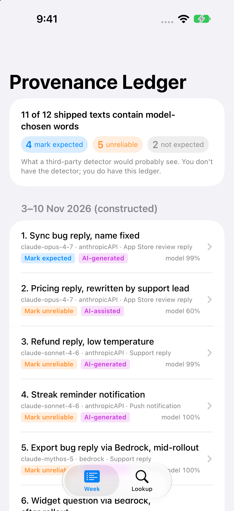
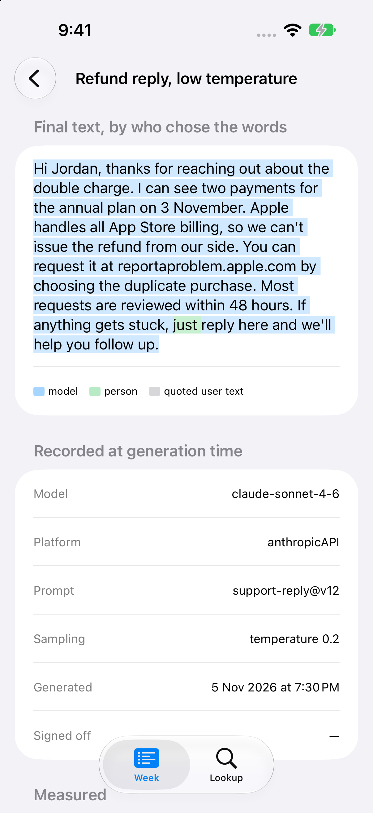
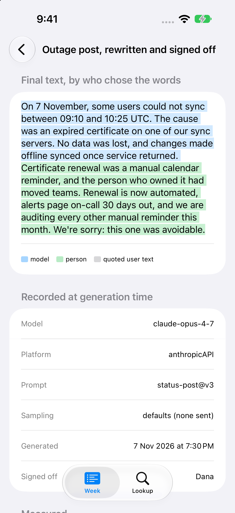
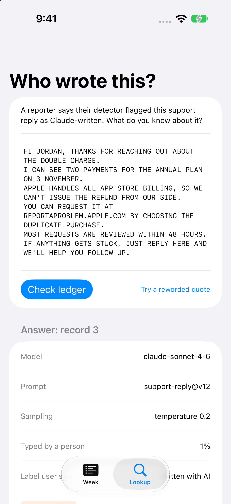

# ProvenanceLedger

**Claude's text watermark tells a third party that Claude was probably involved. It does not tell anyone how much, and your team can't run the detector.** This is a small Swift library and iOS demo for the part you *can* own: recording, at generation time and through every human edit, who chose the words your app ships.

Article: (added after publish)



## What's in it

| Type | What it does |
| --- | --- |
| `AttributedText` | Text whose characters remember their origin: `.model(GenerationID)`, `.human(author:)` or `.quoted` (user text the model was told to carry verbatim, which counts for neither side). |
| `AttributedText.edited(to:by:)` | Applies a human edit with a token-level LCS diff. Changed words go to the editor as whole words; surviving model runs shorter than 3 words that touch typed text are handed to the editor, so a rewrite that reuses "the" and "you" is not credited to the model. Very large changed regions fall back to the editor wholesale (under-counts the model, never over-counts). |
| `MarkExpectationRules` | Turns Anthropic's *documented* caveats into an expectation per text: `.expected`, `.weak([reasons])` or `.notExpected(reason)`. Reasons: Sonnet 4.6 with non-default `temperature`/`top_p`/`top_k`, fewer than 5 model-majority sentences, more than 50% typed by a person, Bedrock's 3–10 Nov rollout window, generated before coverage, or a model with no documented start date ("not documented", never "unmarked"). |
| `WatermarkCoverage.documentedNov2026` | The coverage table, as data you own. Replace the model strings with your account's exact IDs. |
| `DisclosurePolicy` | The team's label policy as reviewable code: no label below 10% model share; "Drafted with AI, edited by our team" only when a person typed at least 20% (a spelling pass is a formal check, not an edit); public status posts also need a named sign-off. |
| `ProvenanceLedger` | Append-only records keyed by a normalized FNV-1a fingerprint (case, whitespace and invisible format characters ignored, wording not), so you can answer "who wrote this?" when someone quotes your text back at you. |
| `StructuredDraft` | The prompt-side technique: ask Claude for JSON segments (`generated` / `quoted`) and **verify** every "quoted" segment is a verbatim substring of the user input before trusting it. Otherwise the model can launder its own words out of the record by calling them quotes. |

```swift
let draft = AttributedText.model(reply, generation: GenerationID(requestID))
let final = draft.edited(to: textFieldValue, by: "priya")

var ledger = ProvenanceLedger(rules: MarkExpectationRules(coverage: .documentedNov2026))
let record = ledger.record(stamp: stamp, surface: .reviewReply,
                           draft: draft, final: final, signoff: nil)

record.expectation        // .weak([.samplingOverride]) for a Sonnet 4.6 call at temperature 0.2
record.disclosure.label   // .aiGenerated: a 1% edit is a formal check
ledger.answer(for: quotedByAReporter)   // .found([record]) even after reflowing and upper-casing
```

## The constructed week

`SampleWeek` is 12 texts a fictional support and comms team shipped between 3 and 10 Nov 2026. Every number below comes from `swift test` (`SampleWeekReportTests` pins them):

- 11 of 12 contain model-chosen words. The 12th was rewritten from scratch: 0% survives.
- Of those 11: **4** mark expected, **5** unreliable, **2** not expected.
- `claude-opus-4-7` alone produces all three answers in the same week (an onboarding reply generated on 2 Nov, before coverage; a rewritten outage post; untouched replies).
- Labels: 9 "Written with AI", 2 "Drafted with AI, edited by our team", 1 no label.

| Refund reply at temperature 0.2 | Outage post, 55% rewritten, signed off | A reporter's quote, answered |
| --- | --- | --- |
|  |  |  |

## How to run it

```bash
git clone https://github.com/rajatslakhina/ai-text-provenance-article-demo.git
cd ai-text-provenance-article-demo
open Demo.xcodeproj
```

Pick the **Demo** scheme and any iPhone Simulator, then Build & Run. No other setup: the app consumes the library through a local package reference in the same repo.

Library only: `swift build && swift test`.

## Verification status

- `swift build -Xswiftc -warnings-as-errors`: clean. `swift test`: **34 tests, 0 failures** (Xcode 27.2, Swift 6.4.2, macOS 27.2).
- Simulator: built with `xcodebuild` for a fresh iPhone 18 Pro (iOS 27.2) simulator, installed, and launched four times via `Scripts/simulator-screenshots.sh` (week list, two detail screens, lookup). The script fails if the app is not running 8 seconds after each launch. Screens were reached with launch arguments, not taps. The screenshots above are from that run.
- CI runs the same build, tests and Simulator script on `macos-15`.

## What this is not

It is not a watermark detector and does not estimate one. "Mark expected" means "the documented caveats don't apply", nothing more. Anthropic publishes no accuracy or false-positive figures for its detector. The thresholds (5 sentences, 50%, 20%, 10%) are this demo's policy choices, written down so they can be argued with.

## Sources

- Anthropic's coverage, sampling caveat, Bedrock date and detector access, as reported by Rajesh Beri: [Claude's Text Watermark Now Covers Mythos 5, Opus 4.7 and Sonnet 4.6](https://www.beri.net/article/claude-text-watermark-mythos-5-opus-4-7-sonnet-4-6-november-3-no-opt-out-article-50-detection-api-vs-openai-textgrain) (4 Nov 2026), which links Anthropic's release notes, help center and developer docs.
- How the mark works and its limits on short, factual and heavily rewritten text: Matthias Bastian, [The Decoder](https://the-decoder.com/anthropic-announces-watermark-detection-api-that-will-let-third-parties-detect-claudes-ai-texts/) (14 Aug 2026).

MIT licensed.
